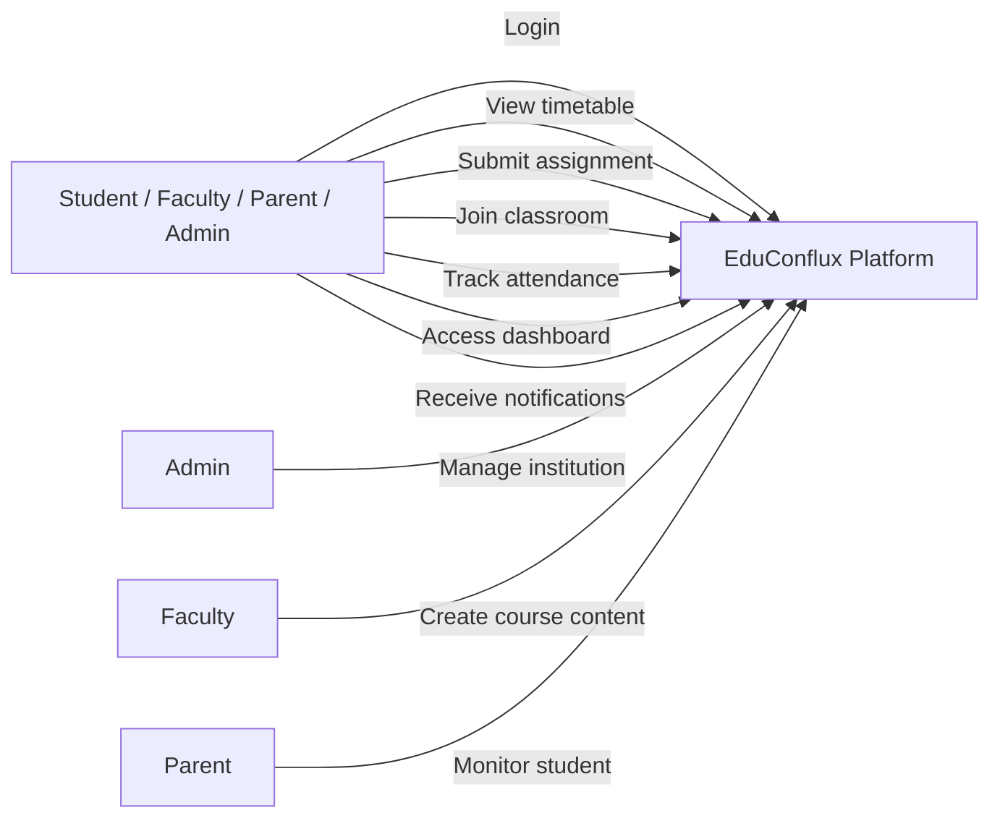
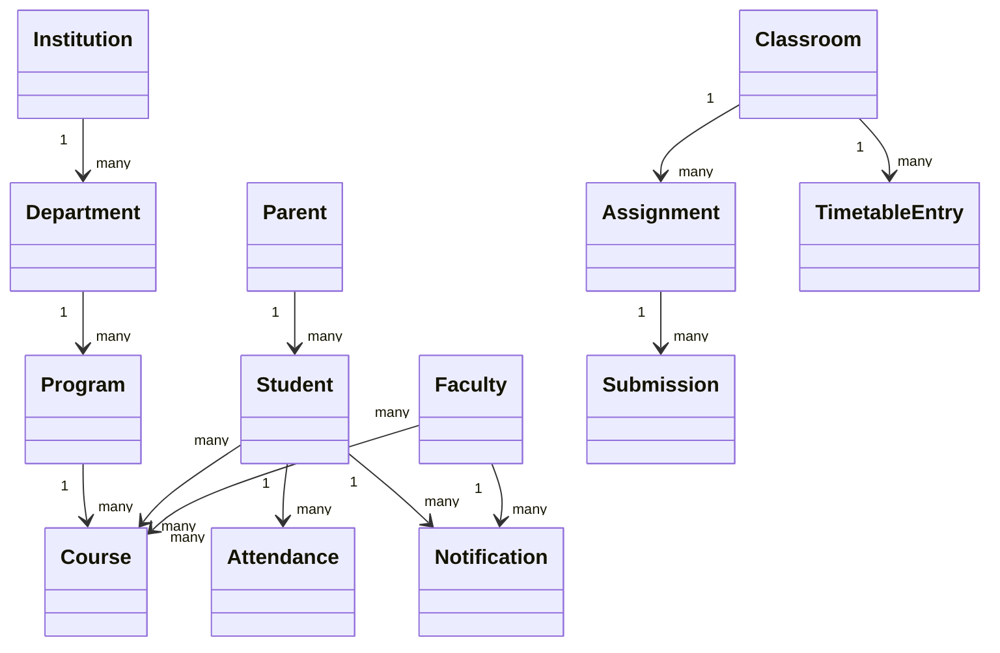
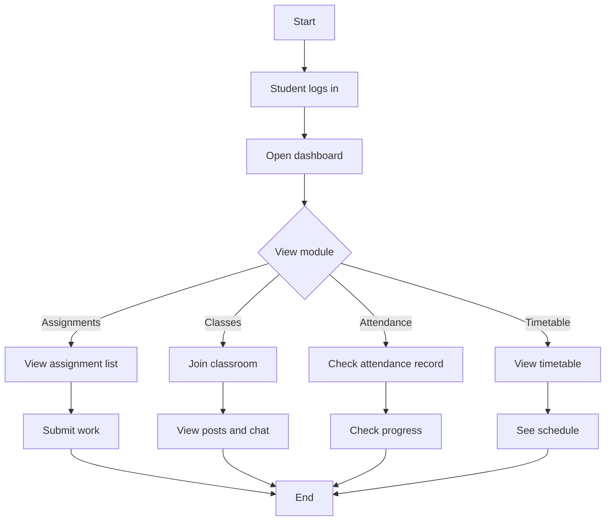
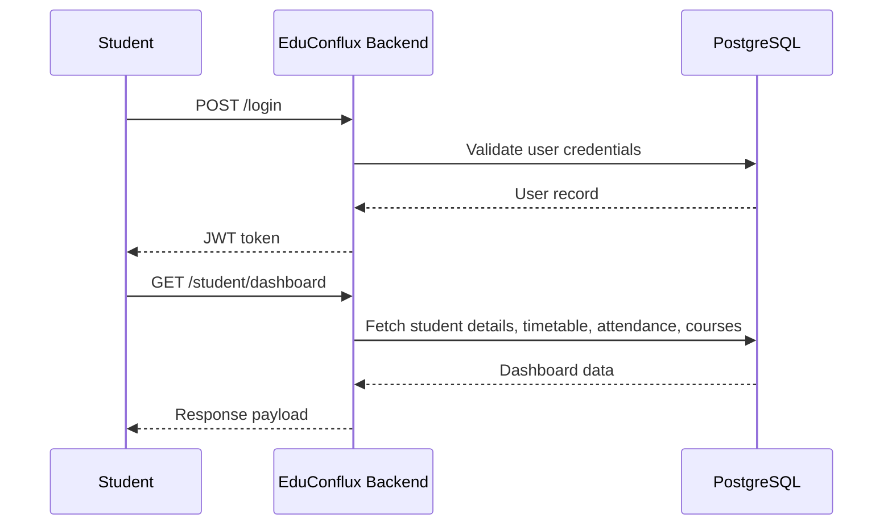
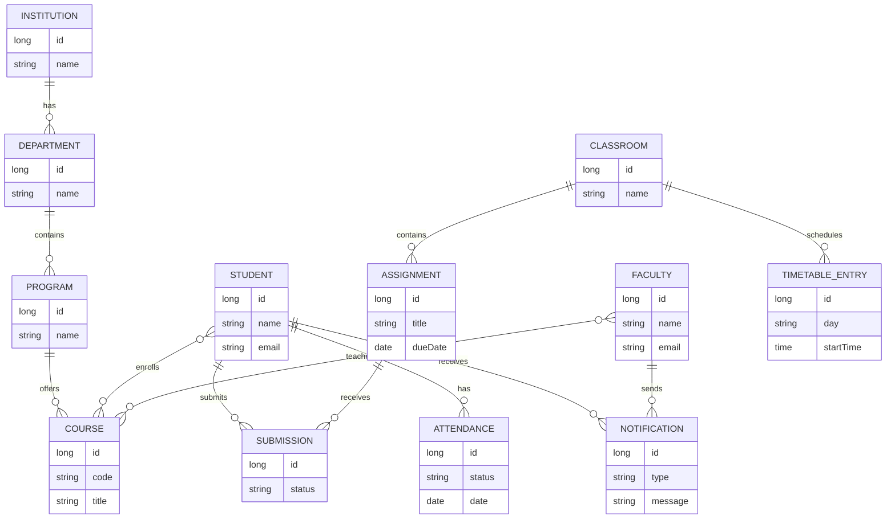

# EduConflux Backend

EduConflux Backend is the Java Spring Boot service that powers the EduConflux platform. It brings together academic administration, learning management, classroom communication, attendance, timetables, assignments, notifications, and institutional workflows in one backend system.

This project solves the problem of fragmented school systems by integrating the core operations that institutions normally manage across separate tools.

## Why this project exists

Educational institutions often use isolated systems for:

- academic management
- classrooms and communication
- assignments and submissions
- attendance and timetables
- parent/student communication
- file sharing and notifications

EduConflux consolidates these functions into a single platform so students, faculty, parents, and administrators can work from one connected system.

## Tech stack

- Java 21
- Spring Boot 3 / Spring Security
- Spring Data JPA
- PostgreSQL
- Maven
- JWT authentication
- WebSocket for classroom chat
- AWS S3 / Supabase-compatible storage
- Mail integration

## Project structure

```text
src/
├── main/
│   ├── java/com/projects/EduConflux/
│   │   ├── academic/
│   │   ├── assignment/
│   │   ├── attendance/
│   │   ├── classroom/
│   │   ├── curriculum/
│   │   ├── dashboard/
│   │   ├── faculty/
│   │   ├── files/
│   │   ├── identity/
│   │   ├── institution/
│   │   ├── learning/
│   │   ├── notification/
│   │   ├── parent/
│   │   ├── search/
│   │   ├── student/
│   │   ├── timetable/
│   │   ├── common/
│   │   ├── config/
│   │   └── ...
│   └── resources/
│       └── application.properties
└── test/
```

## Local setup

### 1) Prerequisites

Make sure you have:

- Java 21+
- Maven 3.9+
- PostgreSQL database
- Git

### 2) Clone the repository

```bash
git clone https://github.com/EduConflux/educonflux-backend.git
cd educonflux-backend
```

### 3) Configure environment variables

Create a local environment file or export these variables before running the app:

```bash
export DATABASE_URL=jdbc:postgresql://localhost:5432/educonflux
export DATABASE_USERNAME=postgres
export DATABASE_PASSWORD=your_password
export JWT_SECRET=replace-with-a-strong-secret
export MAIL_USERNAME=your_email@gmail.com
export MAIL_PASSWORD=your_email_app_password
export SUPABASE_URL=https://your-project.supabase.co
export SUPABASE_ANON_KEY=your_anon_key
export SUPABASE_S3_ENDPOINT=https://your-project.supabase.co/storage/v1/s3
export SUPABASE_S3_ACCESS_KEY=your_access_key
export SUPABASE_S3_SECRET_KEY=your_secret_key
export SUPABASE_S3_REGION=ap-south-1
export SUPABASE_S3_BUCKET_NAME=educonflux-bucket
```

The app also imports `application-local.properties` if present. You can create it for local-only settings.

### 4) Create the database

Create a PostgreSQL database named `educonflux` or use your own database name matching `DATABASE_URL`.

### 5) Install dependencies

```bash
./mvnw install
```

### 6) Run the backend locally

```bash
./mvnw spring-boot:run
```

The app should start on:

```text
http://localhost:8080
```

### 7) Run tests

```bash
./mvnw test
```

## Default app behavior

- Spring Boot loads `application.properties`
- Database configuration comes from environment variables
- JPA will create/update schema automatically with `spring.jpa.hibernate.ddl-auto=update`
- Security uses JWT-based authentication
- Classroom features support WebSocket chat

## Common development notes

- If Maven wrapper is not executable, run:

```bash
chmod +x mvnw
```

- If you use Windows, run:

```bash
mvnw.cmd spring-boot:run
```

## Mermaid diagrams

### Use Case Diagram



### Class Diagram



### Activity Diagram



### Sequence Diagram



### ER Diagram



## Summary

EduConflux Backend is a modular education platform backend designed to connect academic, classroom, communication, and administration workflows into one system. It is built to support the daily needs of schools, colleges, and educational institutions with a single, unified backend.

For local development, the main requirement is to set the needed environment variables, start PostgreSQL, and run the Spring Boot app with Maven.

## License

This project is currently configured as a local application project. Add your license if needed before publishing.
