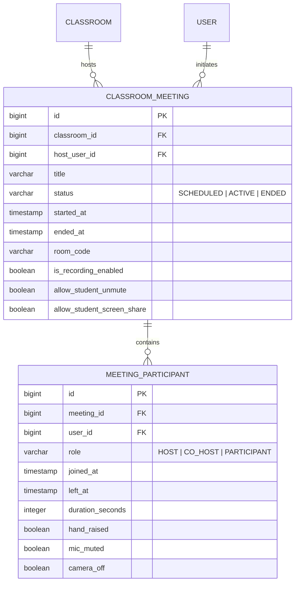

# WebRTC Real-Time Classroom Video Meeting Architecture & Implementation Plan

> **EduConflux Collaborative Classroom Suite**  
> **Status:** Architecture & Implementation Blueprint  
> **Target Package:** `com.projects.EduConflux.classroom.meeting`  
> **Frontend Target:** `src/features/meeting` & `src/features/classrooms`

---

## 1. Executive Summary

This document specifies the technical design, protocol specifications, database schemas, signaling workflows, and step-by-step implementation plan for introducing **Real-Time WebRTC Video Meetings** into each EduConflux Classroom.

Every classroom will have an integrated virtual lecture room where faculty instructors can conduct live lectures, share screens, manage student participants, and automatically track lecture attendance, while enrolled students can join with two-way audio, video, in-call chat, and hand-raising capabilities.

```mermaid
flowchart TD
    subgraph Clients["Classroom Clients (Web Browser)"]
        Teacher["Teacher (Host)"]
        StudentA["Student A"]
        StudentB["Student B"]
    end

    subgraph Backend["EduConflux Backend (Spring Boot)"]
        Auth["JWT Security & Classroom ACL"]
        Signaling["STOMP WebSocket Signaling (/app/classroom/{id}/meeting)"]
        DB[(PostgreSQL Database)]
        Attendance["Attendance Auto-Tracker"]
    end

    subgraph Infrastructure["Media & Traversal Infrastructure"]
        STUN["STUN Servers (Google / Coturn)"]
        TURN["TURN Relay Server (Coturn / Cloud)"]
    end

    Teacher <-->|STOMP Signaling (SDP / ICE)| Signaling
    StudentA <-->|STOMP Signaling (SDP / ICE)| Signaling
    StudentB <-->|STOMP Signaling (SDP / ICE)| Signaling

    Teacher -.->|NAT Traversal / Candidate Discovery| STUN
    StudentA -.->|NAT Traversal / Candidate Discovery| STUN

    Teacher <===>|WebRTC P2P / SFU Media Stream| StudentA
    Teacher <===>|WebRTC P2P / SFU Media Stream| StudentB
    StudentA <===>|WebRTC P2P / SFU Media Stream| StudentB

    Signaling --> Auth
    Signaling --> DB
    DB --> Attendance
```

---

## 2. WebRTC Architecture Comparison: Mesh vs. SFU

Video conferencing architectures differ fundamentally in how media packets (audio/video) flow between peers:

| Feature / Metric | Mesh (P2P Full Mesh) | SFU (Selective Forwarding Unit) | EduConflux Approach |
| :--- | :--- | :--- | :--- |
| **Media Routing** | Directly peer-to-peer ($N \times (N-1)$ connections) | Clients send 1 upstream to SFU; SFU forwards downstream | **Phase 1: Hybrid Mesh / Broadcast**<br>**Phase 2: Dedicated SFU (LiveKit / Mediasoup)** |
| **Server Infrastructure** | Zero media server overhead (Spring Boot acts purely as Signaling broker) | Requires media server instance (WebRTC gateway) | Uses existing Spring Boot WebSocket STOMP infrastructure for signaling |
| **Max Participants** | 4 – 8 participants with full video | 50 – 500+ participants | In Lecture Mode: Teacher publishes video/screen; students stream audio or request to speak |
| **Bandwidth (Client)** | High ($N-1$ uploads and downloads) | Low (1 upload, $N-1$ downloads) | Optimized with teacher spotlight + audio-only fallback for students |
| **Time-to-Ship** | Fast (builds on top of existing `/ws` STOMP broker) | Medium (requires setting up SFU daemon) | Phase 1 gets native classroom meetings live without external dependencies |

---

## 3. Database Schema & Data Models

### 3.1 Entity Relationship Diagram



### 3.2 Java Entity Definitions

#### `ClassroomMeeting.java`
```java
package com.projects.EduConflux.classroom.meeting.entity;

import com.projects.EduConflux.classroom.entity.Classroom;
import com.projects.EduConflux.identity.entity.User;
import jakarta.persistence.*;
import lombok.*;
import java.time.LocalDateTime;

@Entity
@Table(name = "classroom_meetings")
@Getter @Setter @NoArgsConstructor @AllArgsConstructor @Builder
public class ClassroomMeeting {

    @Id
    @GeneratedValue(strategy = GenerationType.IDENTITY)
    private Long id;

    @ManyToOne(fetch = FetchType.LAZY, optional = false)
    @JoinColumn(name = "classroom_id", nullable = false)
    private Classroom classroom;

    @ManyToOne(fetch = FetchType.LAZY, optional = false)
    @JoinColumn(name = "host_user_id", nullable = false)
    private User hostUser;

    @Column(nullable = false, length = 150)
    private String title;

    @Enumerated(EnumType.STRING)
    @Column(nullable = false, length = 20)
    private MeetingStatus status; // SCHEDULED, ACTIVE, ENDED

    @Column(nullable = false, unique = true, length = 64)
    private String roomCode; // e.g. "clr-12-m-49fa23"

    private LocalDateTime scheduledStartTime;
    private LocalDateTime startedAt;
    private LocalDateTime endedAt;

    @Builder.Default
    private boolean allowStudentUnmute = true;

    @Builder.Default
    private boolean allowStudentScreenShare = false;

    private LocalDateTime createdAt;
}
```

#### `MeetingParticipant.java`
```java
package com.projects.EduConflux.classroom.meeting.entity;

import com.projects.EduConflux.identity.entity.User;
import jakarta.persistence.*;
import lombok.*;
import java.time.LocalDateTime;

@Entity
@Table(name = "meeting_participants")
@Getter @Setter @NoArgsConstructor @AllArgsConstructor @Builder
public class MeetingParticipant {

    @Id
    @GeneratedValue(strategy = GenerationType.IDENTITY)
    private Long id;

    @ManyToOne(fetch = FetchType.LAZY, optional = false)
    @JoinColumn(name = "meeting_id", nullable = false)
    private ClassroomMeeting meeting;

    @ManyToOne(fetch = FetchType.LAZY, optional = false)
    @JoinColumn(name = "user_id", nullable = false)
    private User user;

    @Enumerated(EnumType.STRING)
    @Column(nullable = false, length = 20)
    private ParticipantRole role; // HOST, CO_HOST, PARTICIPANT

    @Column(nullable = false)
    private LocalDateTime joinedAt;
    private LocalDateTime leftAt;
    private Integer durationSeconds;

    @Builder.Default
    private boolean handRaised = false;

    @Builder.Default
    private boolean micMuted = false;

    @Builder.Default
    private boolean cameraOff = false;
}
```

---

## 4. WebSocket STOMP Signaling Protocol

EduConflux already has a production-ready STOMP endpoint registered at `/ws` with `JwtStompInterceptor`. WebRTC signaling leverages this broker directly.

```mermaid
sequenceDiagram
    autonumber
    actor T as Teacher (Peer A)
    participant WS as Spring Boot WebSocket (/ws)
    actor S as Student (Peer B)

    Note over T,S: 1. Room Handshake & Peer Discovery
    T->>WS: SEND /app/classroom/{id}/meeting/join
    WS-->>T: Message (room-state, active-participants)
    S->>WS: SEND /app/classroom/{id}/meeting/join
    WS-->>T: BROADCAST /topic/classroom/{id}/meeting/peers (User B Joined)

    Note over T,S: 2. WebRTC SDP Offer / Answer Exchange
    T->>T: createOffer() -> setLocalDescription()
    T->>WS: SEND /app/classroom/{id}/meeting/signal (type: "OFFER", target: B, sdp: ...)
    WS->>S: SEND /queue/user/{B}/meeting/signal (from: A, type: "OFFER")
    S->>S: setRemoteDescription() -> createAnswer() -> setLocalDescription()
    S->>WS: SEND /app/classroom/{id}/meeting/signal (type: "ANSWER", target: A, sdp: ...)
    WS->>T: SEND /queue/user/{A}/meeting/signal (from: B, type: "ANSWER")
    T->>T: setRemoteDescription()

    Note over T,S: 3. Trickle ICE Candidate Exchange
    T->>WS: SEND /app/classroom/{id}/meeting/ice (candidate, target: B)
    WS->>S: /queue/user/{B}/meeting/ice
    S->>WS: SEND /app/classroom/{id}/meeting/ice (candidate, target: A)
    WS->>T: /queue/user/{A}/meeting/ice

    Note over T,S: 4. Direct P2P Media Stream Established
    T==>>S: Direct Encrypted SRTP Audio/Video & Screen Share
```

### 4.1 Signaling Message Contract

```typescript
export type SignalMessageType =
  | 'ROOM_JOINED'
  | 'PEER_JOINED'
  | 'PEER_LEFT'
  | 'OFFER'
  | 'ANSWER'
  | 'ICE_CANDIDATE'
  | 'MEDIA_STATE_CHANGED'
  | 'HAND_RAISE'
  | 'HOST_ACTION'
  | 'MEETING_ENDED';

export interface WebRTCSignalMessage {
  type: SignalMessageType;
  senderId: number;
  senderName: string;
  senderRole: 'HOST' | 'PARTICIPANT';
  targetUserId?: number; // specific recipient (for 1:1 SDP/ICE)
  sdp?: RTCSessionDescriptionInit;
  candidate?: RTCIceCandidateInit;
  mediaState?: {
    isAudioMuted: boolean;
    isVideoOff: boolean;
    isScreenSharing: boolean;
    isHandRaised: boolean;
  };
  hostCommand?: 'MUTE_AUDIO' | 'KICK' | 'END_MEETING';
  timestamp: string;
}
```

### 4.2 Spring Boot Signaling Controller

```java
@Controller
@RequiredArgsConstructor
public class MeetingSignalingController {

    private final SimpMessagingTemplate messagingTemplate;
    private final ClassroomMeetingService meetingService;

    // 1. Join Meeting Room
    @MessageMapping("/classroom/{classroomId}/meeting/join")
    public void handleJoin(
            @DestinationVariable Long classroomId,
            Principal principal) {
        
        MeetingParticipantResponse participant = 
                meetingService.joinMeeting(classroomId, principal);

        // Broadcast to other peers in classroom that a new participant joined
        messagingTemplate.convertAndSend(
                "/topic/classroom/" + classroomId + "/meeting/peers",
                WebRTCSignalMessage.builder()
                        .type(SignalMessageType.PEER_JOINED)
                        .senderId(participant.getUserId())
                        .senderName(participant.getUserName())
                        .senderRole(participant.getRole())
                        .build()
        );
    }

    // 2. Relay Targeted WebRTC Signal (Offer / Answer)
    @MessageMapping("/classroom/{classroomId}/meeting/signal")
    public void relaySignal(
            @DestinationVariable Long classroomId,
            @Payload WebRTCSignalMessage message,
            Principal principal) {
        
        // Direct route to target peer's private queue
        messagingTemplate.convertAndSendToUser(
                String.valueOf(message.getTargetUserId()),
                "/queue/meeting/signal",
                message
        );
    }

    // 3. Relay Trickle ICE Candidates
    @MessageMapping("/classroom/{classroomId}/meeting/ice")
    public void relayIceCandidate(
            @DestinationVariable Long classroomId,
            @Payload WebRTCSignalMessage message,
            Principal principal) {
        
        messagingTemplate.convertAndSendToUser(
                String.valueOf(message.getTargetUserId()),
                "/queue/meeting/ice",
                message
        );
    }

    // 4. Leave Meeting Room
    @MessageMapping("/classroom/{classroomId}/meeting/leave")
    public void handleLeave(
            @DestinationVariable Long classroomId,
            Principal principal) {
        
        Long userId = SecurityUtils.getUserId(principal);
        meetingService.leaveMeeting(classroomId, userId);

        messagingTemplate.convertAndSend(
                "/topic/classroom/" + classroomId + "/meeting/peers",
                WebRTCSignalMessage.builder()
                        .type(SignalMessageType.PEER_LEFT)
                        .senderId(userId)
                        .build()
        );
    }
}
```

---

## 5. REST Endpoints Specification

| Method | Endpoint | Authorized Roles | Description |
| :--- | :--- | :--- | :--- |
| `POST` | `/api/classrooms/{classroomId}/meetings` | `FACULTY`, `INSTITUTION_ADMIN` | Start a new live meeting or schedule one. |
| `GET` | `/api/classrooms/{classroomId}/meetings/active` | `FACULTY`, `STUDENT`, `INSTITUTION_ADMIN` | Fetch current active meeting details and room code. |
| `POST` | `/api/classrooms/{classroomId}/meetings/{meetingId}/end` | `FACULTY`, `INSTITUTION_ADMIN` | Host ends meeting for everyone & calculates attendance logs. |
| `GET` | `/api/classrooms/{classroomId}/meetings/{meetingId}/participants` | Enrolled Classroom Members | List all participants and current audio/video/hand status. |
| `GET` | `/api/classrooms/{classroomId}/meetings/history` | `FACULTY`, `INSTITUTION_ADMIN` | Historical meeting logs and attendance durations. |
| `GET` | `/api/classrooms/{classroomId}/meetings/ice-servers` | Enrolled Classroom Members | Fetch STUN/TURN configuration and ephemeral credentials. |

---

## 6. Frontend WebRTC Architecture

### 6.1 State Management & Custom Hook (`useWebRTCMeeting`)

The client encapsulates browser media devices, peer connections, and STOMP messaging in a clean reusable hook:

```
src/features/meeting/
├── api/
│   └── meetingApi.ts              // REST endpoints (start, end, active, history)
├── hooks/
│   ├── useWebRTCMeeting.ts        // Core WebRTC PeerConnection & STOMP coordinator
│   ├── useUserMedia.ts            // Mic, camera, and screen capture tracks
│   └── useAudioLevel.ts           // AudioContext active speaker detector
├── components/
│   ├── ClassroomMeetingRoom.tsx   // Main full-screen meeting container
│   ├── VideoGrid.tsx              // Dynamic grid (1x1, 2x2, Spotlight/Presenter mode)
│   ├── VideoTile.tsx              // Single peer video box with audio badge & name tag
│   ├── MeetingToolbar.tsx         // Mic, Camera, ScreenShare, Hand, Chat, Leave buttons
│   ├── InCallChatDrawer.tsx       // Real-time chat sidebar during call
│   ├── ParticipantsDrawer.tsx     // Hand raise queue & host mute-all controls
│   └── DeviceSettingsModal.tsx    // Mic/Camera input selection modal
└── types.ts                       // Signal messages, participant states
```

### 6.2 Key Frontend Meeting Features

1. **Host Lecture Controls**:
   * **Start Meeting**: Faculty can launch an instant session directly from the Classroom Hub header.
   * **Mute All**: One-click mute for all student audio tracks to ensure quiet lectures.
   * **Screen Sharing**: Present lecture slides, browser tabs, or code windows with system audio.
   * **End for All**: Concludes the session, stops recording, and exports attendance.
2. **Student Experience**:
   * **One-Click Join**: Banner alert appears in classroom when a live lecture is active.
   * **Raise Hand**: Queue system notifies instructor when a student has a question.
   * **Bandwidth Optimization**: Automatic low-bitrate mode when network latency increases.
3. **Active Speaker Detection**:
   * Uses `AudioContext` and `AnalyserNode` to compute volume RMS and highlights the speaking participant's video tile in orange (`#F97316`).

---

## 7. STUN / TURN Server Configuration

WebRTC connections between devices behind NATs or firewalls require STUN/TURN servers:

1. **Development & Testing**:
   ```javascript
   const iceServers = [
     { urls: 'stun:stun.l.google.com:19302' },
     { urls: 'stun:stun1.l.google.com:19302' },
   ];
   ```

2. **Production Deployment**:
   * Deploy **Coturn** (open-source) on Ubuntu:
     ```bash
     sudo apt-get install coturn
     # /etc/turnserver.conf:
     # listening-port=3478
     # tls-listening-port=5349
     # realm=educonflux.com
     # user=educonflux:SecureTurnSecretKey!
     ```
   * Or use a cloud TURN provider (e.g. Metered, Twilio, or Cloudflare Calls).

---

## 8. Implementation Roadmap & TODO Checklist

### Phase 1: Backend Data Models & Core REST APIs
- [ ] Create `ClassroomMeeting` and `MeetingParticipant` JPA entities.
- [ ] Create `ClassroomMeetingRepository` and `MeetingParticipantRepository`.
- [ ] Implement `ClassroomMeetingService` with role verification (enrolled student / faculty check).
- [ ] Implement `ClassroomMeetingController` for CRUD, active check, and end session.

### Phase 2: STOMP Signaling Broker Infrastructure
- [ ] Define `WebRTCSignalMessage` DTO and `SignalMessageType` enums.
- [ ] Create `MeetingSignalingController` mapping join, leave, offer, answer, and ICE candidate events.
- [ ] Connect host control events (`MUTE_ALL`, `HAND_RAISE`, `KICK`).
- [ ] Unit & integration test STOMP routing with Mock WebSocket sessions.

### Phase 3: Client WebRTC Engine (`useWebRTCMeeting`)
- [ ] Implement `useUserMedia` for `navigator.mediaDevices.getUserMedia` & `getDisplayMedia`.
- [ ] Implement `useWebRTCMeeting` managing multiple `RTCPeerConnection` instances.
- [ ] Wire STOMP client message subscriptions (`/topic/...` and `/queue/...`).
- [ ] Handle trickle ICE candidate pooling and asynchronous SDP negotiation.

### Phase 4: Frontend UI Components & Classroom Hub Integration
- [ ] Build `VideoTile.tsx` (avatar fallback when camera is off, mute icon, name label).
- [ ] Build `VideoGrid.tsx` with responsive layout and presenter spotlight mode.
- [ ] Build `MeetingToolbar.tsx` with mute mic, stop video, screen share, raise hand, and leave actions.
- [ ] Embed "Join Live Meeting" banner and "Start Video Call" button in `ClassroomHub.tsx`.

### Phase 5: Attendance Integration & Polish
- [ ] Log participant join and leave timestamps to compute total minutes attended.
- [ ] Add post-meeting summary showing attendance percentages to faculty.
- [ ] Test cross-browser compatibility (Chrome, Firefox, Safari, Edge, Mobile Web).

